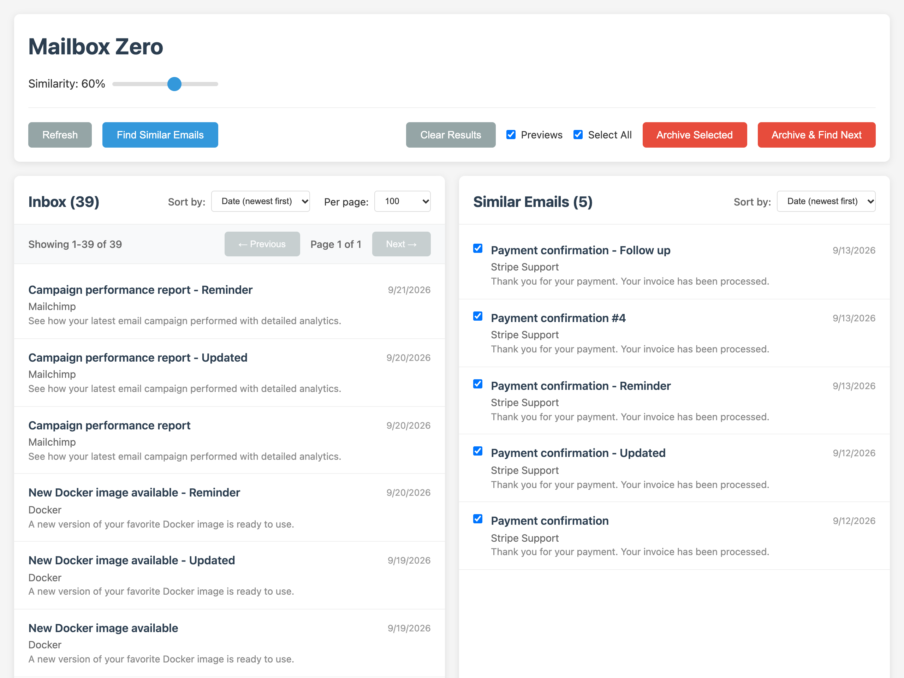

# Mailbox Zero - Email Cleanup Helper

[](https://github.com/taskinen/mailboxzero/actions/workflows/test.yml)
[](https://go.dev/)
[](https://go.dev/)

A Go-based web application that helps you clean up your Fastmail inbox by finding and archiving similar emails using JMAP protocol.



## Features

- **Safe Operations**: Built-in dry run mode prevents accidental changes
- **Dual-pane Interface**: View inbox on left, grouped similar emails on right
- **Smart Similarity Matching**: Fuzzy matching based on subject, sender, and email content
- **Adjustable Similarity Threshold**: Fine-tune matching with a percentage slider
- **Selective Archiving**: Choose which emails to archive with confirmation dialog
- **Rapid Archive Loop**: "Archive & Find Next" button archives the current selection without confirmation and immediately re-runs the similarity search
- **Undo Archive**: After each successful archive a status pill with an "Undo" button appears in the top-right of the action bar to restore the just-archived messages
- **Individual Email Selection**: Select specific emails to find similar matches
- **Mock Mode**: Run against built-in sample data — no Fastmail credentials required

## Safety Features

- **DRY RUN MODE**: All write operations are disabled by default; archiving then only says how many emails it would have archived
- **Archive Only**: The only write operations move emails from the inbox to the archive and, with Undo, back again (never deletes); any other labels on an email are kept
- **Confirmation Dialog**: Required before archiving via "Archive Selected" (the opt-in "Archive & Find Next" button intentionally skips it)
- **Undo Archive**: An "Undo" button appears after each successful archive and moves the affected messages back to the inbox via `POST /api/unarchive`
- **Visual Warnings**: Clear indication when in dry run mode
- **Flagged Emails Stay**: Emails you flagged in Fastmail start unselected in a group of similar emails, so archiving the group leaves them in your inbox unless you select them

## Installation

Mailbox Zero is a single program that serves its web page on your own computer. You need a Fastmail account and a Fastmail API token ([below](#getting-fastmail-api-token)). Install the program in one of two ways.

### With Go

With [Go](https://go.dev/dl/) 1.26 or later (Go 1.21 or later downloads Go 1.26 by itself):

```bash
go install github.com/taskinen/mailboxzero@latest
```

This builds the latest release and puts the `mailboxzero` program in `$(go env GOPATH)/bin`, usually `~/go/bin`. Make sure that folder is on your `PATH`.

### Ready-built program

Download the archive for your system from the [latest release](https://github.com/taskinen/mailboxzero/releases/latest), together with `checksums.txt`: `mailboxzero_<version>_<os>_<arch>.tar.gz`, or `.zip` for Windows. The `<os>` is `linux`, `darwin` (macOS) or `windows`, and the `<arch>` is `amd64` (Intel and AMD) or `arm64` (Apple silicon and other ARM).

1. Check the download, in the folder you downloaded to:
   ```bash
   sha256sum --ignore-missing -c checksums.txt       # Linux
   shasum -a 256 --ignore-missing -c checksums.txt   # macOS
   ```
2. Unpack it. Its folder holds the `mailboxzero` program (`mailboxzero.exe` on Windows), an example config, this README and the license. Move the program to a folder on your `PATH`, such as `~/.local/bin` or `/usr/local/bin`.
3. The programs are not signed by Apple or Microsoft:
   - **macOS** blocks a program downloaded with a browser. Allow it once with `xattr -d com.apple.quarantine mailboxzero`, or start it, then choose System Settings → Privacy & Security → Open Anyway.
   - **Windows** SmartScreen may warn when you start it; choose More info → Run anyway.

### First Run

1. Create the configuration file where Mailbox Zero looks for it, `~/.config/mailboxzero/config.yaml`:
   ```bash
   mkdir -p ~/.config/mailboxzero
   mailboxzero -example-config > ~/.config/mailboxzero/config.yaml
   chmod 600 ~/.config/mailboxzero/config.yaml   # it will hold your API token
   ```
   If you set `XDG_CONFIG_HOME`, the file is `$XDG_CONFIG_HOME/mailboxzero/config.yaml` instead. On Windows it is `%USERPROFILE%\.config\mailboxzero\config.yaml`; in PowerShell:
   ```powershell
   mkdir $HOME\.config\mailboxzero
   mailboxzero -example-config > $HOME\.config\mailboxzero\config.yaml
   ```
   To use a file somewhere else, start the program with `-config /path/to/config.yaml`.
2. Put your [Fastmail API token](#getting-fastmail-api-token) in the file's `api_token`.
3. Start the program:
   ```bash
   mailboxzero
   ```
4. Open http://localhost:8080. Dry run mode is on, so nothing changes in your mailbox until you [enable real changes](#enabling-real-changes); the page shows a warning banner while it is on.

### Getting Fastmail API Token

1. Log into your Fastmail account
2. Go to Settings → Privacy & Security → Connected apps & API tokens
3. Click "Manage API tokens", then "New API token"
4. Enter a name (for example "Mailbox Zero") and keep the protocol set to JMAP
5. Under Scopes, select only "Email" (`urn:ietf:params:jmap:mail`), the only one the app uses
6. Leave "Read-only access" off if you want to archive. A read-only token is enough while `dry_run` is `true`, since nothing is changed then, but archiving and Undo need to change your mail
7. Click "Generate API token" and copy the token to your config file

### Updating

- **With Go:** run `go install github.com/taskinen/mailboxzero@latest` again. To install a particular version, give it instead of `latest`, for example `@v1.0.0`.
- **Ready-built program:** download the new release as above and replace the program.

`mailboxzero -version` prints the version you have, and the web page shows it next to the title. The [release notes](https://github.com/taskinen/mailboxzero/releases) say what changed in each version.

### Mock Mode (no Fastmail account required)

For development, testing, or demos you can run against built-in sample data instead of a real Fastmail inbox. In a checkout of this repository:

```bash
go run . -config config-mock.yaml.example
```

Mock mode is enabled by setting `mock_mode: true` in the config; when on, the JMAP endpoint and API token are not required, and Fastmail is never contacted. With `dry_run: true`, as in the example, archiving changes nothing; with `dry_run: false` it removes the archived emails from the in-memory sample inbox (Undo puts them back), until the server restarts.

## Usage

### Basic Workflow

1. **Load Inbox**: The left pane shows your current inbox emails
2. **Find Similar Emails**: 
   - Click "Find Similar Emails" to find all similar email groups (it searches the newest 10,000 emails in your inbox)
   - Or select a specific email and click "Find Similar Emails" to find matches for that email
3. **Adjust Similarity**: Use the percentage slider to fine-tune matching sensitivity
4. **Review Matches**: Similar emails appear in the right pane with checkboxes
5. **Select for Archiving**: Choose which emails to archive (all selected by default, except emails you flagged, marked ⚑; unread emails have a blue dot)
6. **Archive**: Click "Archive Selected" and confirm to move emails to archive folder, or click "Archive & Find Next" to archive immediately without confirmation and automatically search for the next batch of similar emails

### Key Features

- **Similarity Slider**: Adjust from 0-100% to control how strict the matching should be
- **Select All/None**: Quickly select or deselect all found similar emails
- **Individual Selection**: Click on specific emails to select/deselect them
- **Clear Results**: Remove all results from the right pane to start fresh
- **Email Preview**: Hover over an email in either pane to see its subject, sender, date and body in a popup (as text only: a preview never loads an email's images or runs its scripts); the Previews checkbox turns this off

### Keyboard Shortcuts

| Key | Action |
|-----|--------|
| `F` | Find Similar Emails |
| `A` | Archive & Find Next (archives at once, without the confirmation dialog) |
| `U` | Undo the last archive |
| `R` | Refresh the inbox |
| `C` | Clear Results |
| `Escape` | Close the preview or the archive dialog |
| `↑` / `↓` | Move between emails in a list |
| `Enter` / `Space` | Choose the focused inbox email (to find emails similar to it) |

### Enabling Real Changes

**⚠️ WARNING**: Only disable dry run mode when you're confident the application works correctly with your mailbox.

1. Edit your config file (`~/.config/mailboxzero/config.yaml`, or the one you give with `-config`):
   ```yaml
   dry_run: false
   ```

2. Restart the application
3. The warning banner will disappear
4. Archive operations will now actually move emails

## Configuration Options

The configuration file is `~/.config/mailboxzero/config.yaml` (`$XDG_CONFIG_HOME/mailboxzero/config.yaml` when `XDG_CONFIG_HOME` is set), or the file given with `-config`. `mailboxzero -example-config` prints a complete example:

```yaml
server:
  port: 8080              # Web server port
  host: "localhost"       # Web server host: localhost, 127.0.0.1 or ::1 only

jmap:
  endpoint: "https://api.fastmail.com/jmap/session"
  api_token: ""           # Your Fastmail API token

dry_run: true             # Safety feature - set to false to enable changes
default_similarity: 60    # Default similarity percentage (0-100)
mock_mode: false          # Set to true to use built-in sample data (no JMAP needed)
```

## How Similarity Matching Works

The application uses weighted scoring tuned for newsletter and notification clustering:

- **Sender Similarity (50%)** — Structured ladder, not raw string distance. Same full address → 1.0; same domain → 0.8 (suppressed for shared-ESP domains like `sendgrid.net` unless local parts also match); same registrable root domain (e.g. `mail.google.com` ↔ `accounts.google.com`) → 0.7; same specific display name → 0.6.
- **Subject Similarity (30%)** — `max(token Jaccard, Levenshtein)` over a normalized subject with reply/forward prefixes (`Re:`, `Fwd:`, `[list]`) stripped. Common newsletter stop words (`weekly`, `newsletter`, `update`, etc.) are filtered before Jaccard.
- **Content Similarity (20%)** — Jaccard overlap of normalized word tokens (length ≥ 3) from the email's preview text. Full bodies are not downloaded for matching; the app fetches an email's body only when you hover over it to preview it.

Clusters are formed by single-link expansion: an email joins a group if it matches **any** existing member at the threshold, not just the seed — so a sibling that diverges from the group's first email but matches another member still gets pulled in.

To stay fast on large inboxes, grouping only compares emails that could reach the threshold: above 50% only emails whose senders have something in common, and between 30% and 50% also emails whose preview text shares rare words. At 30% and below every pair is compared, so very low thresholds are slower on a big inbox.

## Security Considerations

- **Localhost Only**: The web UI has no login, so the server only listens on this machine. `server.host` must be `localhost`, `127.0.0.1` or `::1`; anything else (including `0.0.0.0`) is rejected at startup. To use it from another machine, forward the port over SSH (`ssh -L 8080:localhost:8080 your-server`) and open http://localhost:8080 locally
- **Browser Protections**: Other websites open in your browser cannot use the app: requests addressed to any host name but localhost are refused (blocking DNS rebinding), and cross-origin `POST` requests are refused (blocking cross-site request forgery). The app also refuses to be shown in another site's frame (blocking clickjacking), and its Content-Security-Policy lets the page run only its own scripts and styles
- **API Tokens**: Use Fastmail API tokens for secure authentication
- **Local Only**: All processing happens locally; the server sends requests only to Fastmail's JMAP API
- **Read-Heavy**: Only reads email data, minimal write operations
- **Archive Only**: Never deletes emails, only moves them to archive

## Troubleshooting

### Config File Not Found
- The program prints where it looked and the commands that create the file (see [First Run](#first-run))
- Give a file in another place with `-config /path/to/config.yaml`

### Authentication Errors
- Verify your Fastmail API token is correct
- Ensure JMAP is enabled in your Fastmail account
- Check network connectivity

### No Emails Found
- Verify you have emails in your inbox
- Check if your account has the expected mailbox structure

### Similarity Issues
- Try adjusting the similarity threshold
- Some emails may have very little content to compare
- Ensure emails have sufficient text in subject/preview

## Development

Run it from a checkout of the source:

```bash
git clone https://github.com/taskinen/mailboxzero.git
cd mailboxzero
go run .                       # reads ~/.config/mailboxzero/config.yaml, like the installed program
go run . -config config.yaml   # or a config file in the checkout (git-ignored)
go build -o mailboxzero .      # a single program with the web page built in
```

Run the package (`.`), not `main.go`: only then does Go record the commit in the program, which `-version` and the web page show. Releases are made with [GoReleaser](https://goreleaser.com/) from version tags; see `.goreleaser.yaml`.

The project structure:
```
mailboxzero/
├── main.go                 # Application entry point
├── .goreleaser.yaml        # Release builds
├── config.yaml.example     # Configuration template (printed by -example-config)
├── config-mock.yaml.example # Mock-mode configuration template
├── e2e/                    # Playwright end-to-end tests
├── internal/
│   ├── config/            # Configuration handling
│   ├── jmap/              # JMAP client implementation
│   ├── server/            # Web server and API handlers
│   ├── similarity/        # Email similarity algorithms
│   └── version/           # Version from Go's build information
└── web/
    ├── web.go             # Builds templates and static files into the binary
    ├── templates/         # HTML templates
    └── static/           # CSS and JavaScript files
```

### Running Tests

The project includes unit tests for every package under `internal/` and for the program itself (`main_test.go`):

```bash
# Run all tests
go test ./...

# Run tests with verbose output
go test ./... -v

# Run tests with coverage
go test ./... -cover

# Generate coverage report
go test ./... -coverprofile=coverage.out
go tool cover -html=coverage.out
```

End-to-end browser tests live in `e2e/` and use [Playwright](https://playwright.dev/) with your installed Google Chrome. They start the server in mock mode on port 18080:

```bash
cd e2e
npm ci
npx playwright test
```

## License

This project is licensed under the MIT License - see the [LICENSE](LICENSE) file for details.
